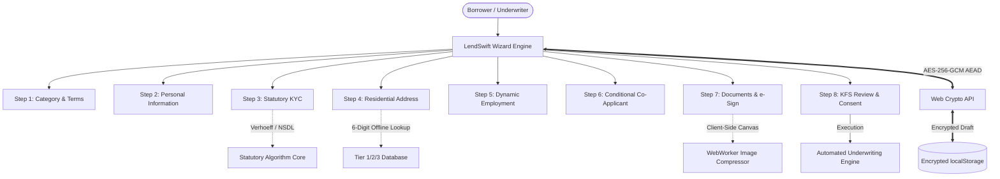
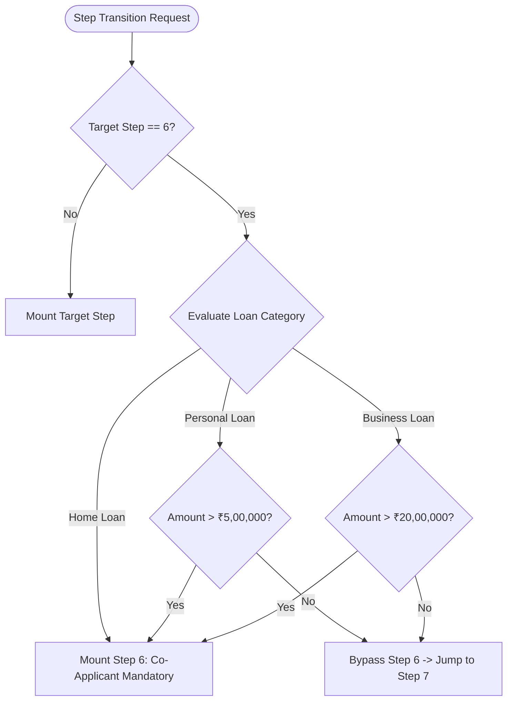
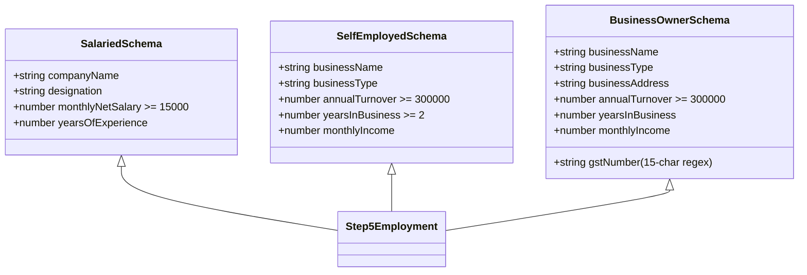
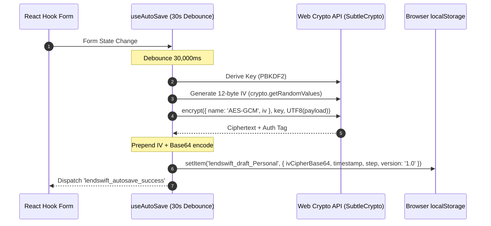

# LendSwift Enterprise Architecture Guide

> **Document Version:** 1.0.0  
> **Target Audience:** FinTech Engineers, Solutions Architects, Compliance & Security Auditors  
> **Statutory Compliance:** RBI Master Directions on Digital Lending (2022/2023), CICRA Act 2005, IT Act 2000, UIDAI Aadhaar Regulations  

---

## 1. Executive Summary & Domain Architecture

**LendSwift** is an enterprise-grade digital lending origination platform built for Non-Banking Financial Companies (NBFC-ICC) and commercial banks in India. The application orchestrates an 8-step loan application journey that marries consumer fintech ergonomics with statutory regulatory controls:

- **NSDL PAN Verification:** Real-time format and 4th-character entity verification (Individual `'P'` for Retail/Home loans; Corporate `'C'` or Firm `'F'` for Commercial loans).
- **UIDAI Verhoeff Checksum:** Mathematical validation of 12-digit Aadhaar numbers using dihedral group $D_5$ permutations, eliminating typos before transmission.
- **Client-Side AES-256-GCM State Encryption:** Zero plaintext PII at rest in `localStorage`, adhering to RBI guidelines on borrower data privacy.
- **Dynamic Risk Underwriting & Affordability Meter:** Real-time reducing-balance EMI calculations, Key Fact Statement (KFS) generation, and Debt-to-Income (FOIR) guardrails.
- **WCAG 2.1 AA Accessibility:** 100% keyboard navigable, screen-reader optimized, and verified via automated `cypress-axe` audits across all 8 steps.



---

## 2. Multi-Step Wizard State Machine

### 2.1 Architectural Rationale

Multi-step loan workflows suffer from two primary failure modes:
1. **Rigid Hardcoded Routing:** Breaks when conditional branching is introduced (e.g. co-applicants or employment-dependent steps).
2. **Uncontrolled Global State:** Causes cascading re-renders across steps, resetting internal state or creating stale form values.

LendSwift resolves this by separating **routing topology** from **data state**. The routing engine is driven by a deterministic predicate state machine declared in `src/components/wizard/stepRegistry.ts`.

### 2.2 Step Registry & Dynamic Step Predicate

Each step is defined by:
- `stepNumber`: 1-based chronological index.
- `id`: Unique identifier key.
- `title` & `description`: Accessible human-readable metadata.
- `isStepVisible(formData: LoanApplicationData)`: Pure predicate evaluating whether the step is active given the current application payload.

```typescript
export interface WizardStepConfig {
  stepNumber: number;
  id: string;
  title: string;
  shortTitle: string;
  description: string;
  isStepVisible: (formData: LoanApplicationData) => boolean;
}
```

### 2.3 Step 6 (Co-Applicant) Dynamic Visibility Matrix

Step 6 (Co-Applicant & Guarantor Details) evaluates dynamically on every state change:

$$\text{Visible} = (T = \text{Home}) \lor (T = \text{Personal} \land A > 500,000) \lor (T = \text{Business} \land A > 2,000,000)$$



### 2.4 Focus Management Contract

On step transition, `StepNavigation.tsx` queries the newly mounted step's DOM tree and programmatically shifts focus to the first interactive element (`input`, `select`, `button`):

```typescript
useEffect(() => {
  const container = formContainerRef.current;
  if (!container) return;
  const firstInteractive = container.querySelector<HTMLElement>(
    'input:not([type="hidden"]):not([disabled]), select:not([disabled]), textarea:not([disabled]), button:not([disabled])'
  );
  if (firstInteractive) {
    firstInteractive.focus();
  }
}, [currentStep]);
```

---

## 3. Form Architecture: Uncontrolled Refs Rationale

### 3.1 Controlled vs. Uncontrolled Performance Comparison

In enterprise financial forms with 50+ fields, real-time masked inputs, and large state payloads, **controlled components** (`value={val}` + `onChange={(e) => setVal(e.target.value)}`) introduce severe UI lag:

| Metric | Controlled State (React `useState`) | Uncontrolled Refs (`react-hook-form`) |
| :--- | :--- | :--- |
| **Keystroke Overhead** | Re-renders entire component subtree ($O(N)$) | Direct DOM mutation, zero re-renders ($O(1)$) |
| **Typing Latency** | 16ms – 48ms (visible stutter on low-end devices) | < 1ms (native browser typing rate) |
| **Layout Thrashing** | High (frequent recalculations of input bounding boxes) | None |
| **Subscription Model** | Coarse-grained (all siblings re-render) | Fine-grained (`watch()` only for subscribing nodes) |

### 3.2 LendSwift Selective Subscription Model

LendSwift uses `react-hook-form` with `useFormContext<LoanApplicationData>()`. Form inputs register their native DOM references:

```tsx
<input
  id="fullName"
  type="text"
  {...register('fullName')}
  aria-invalid={Boolean(errors.fullName)}
  aria-describedby={errors.fullName ? 'fullName-error' : undefined}
/>
```

When dynamic UI requires reactivity (such as updating the EMI calculator when the amount slider moves, or toggling between Salaried and Self-Employed fields), LendSwift isolates the subscription to that specific leaf using `watch('loanAmount')` or `useWatch()`, keeping the surrounding step container completely unrendered.

### 3.3 Input Purging on Branch Switch

When a user switches between `Salaried`, `Self-Employed`, and `Business Owner` in Step 5, obsolete branch fields are instantly purged to prevent **stale data leakage**:

```typescript
// Purge obsolete data when switching to Salaried
if (newType === 'Salaried') {
  setValue('businessName', '');
  setValue('businessType', '');
  setValue('annualTurnover', undefined);
  setValue('yearsInBusiness', undefined);
  setValue('monthlyIncome', undefined);
  setValue('gstNumber', '');
  setValue('businessAddress', '');
  clearErrors(['businessName', 'annualTurnover', 'gstNumber', ...]);
}
```

---

## 4. Zod Schema Composition & Modular Validation Engine

### 4.1 Schema Tree & Composition Strategy

Validation is composed modularly across independent schemas:

```
src/schemas/
├── step1Schema.ts       (Loan type, amount bounds, tenure bounds, purpose)
├── step2Schema.ts       (Personal info, age gate, contact uniqueness)
├── step3Schema.ts       (PAN structure, Aadhaar Verhoeff, consent)
├── step4Schema.ts       (PIN code lookup, residence vintage, address mirroring)
├── step5Schema.ts       (Discriminated union: Salaried | Self-Employed | Business Owner)
├── step6Schema.ts       (Co-applicant PAN, non-identity check, guarantor consent)
├── step7Schema.ts       (Document uploads, mime-types, size limits, e-signature)
├── step8Schema.ts       (4 independent statutory RBI consent declarations)
└── index.ts             (Root composite schema with cross-step superRefine)
```

### 4.2 Discriminated Union Pattern (Step 5)

Step 5 leverages `z.discriminatedUnion('employmentType', [...])` to enforce compile-time and runtime field exclusivity:



### 4.3 Cross-Step Refinement Rules (`superRefine`)

1. **Age + Tenure Gate:**
   $$\text{Age} + \frac{\text{Tenure (months)}}{12} \le 65 \text{ years}$$
   *Rationale:* Borrowers cannot have repayment obligations extending past the statutory retirement age.
2. **Contact Number Divergence:**
   $$\text{mobileNumber} \ne \text{alternateMobile}$$
   *Rationale:* Secondary emergency contact must provide an independent communication channel.
3. **PAN Divergence in Joint Applications:**
   $$\text{coApplicantPan} \ne \text{panNumber}$$
   *Rationale:* Primary borrower and guarantor must be distinct legal entities.
4. **Commercial Loan Occupational Requirement:**
   $$\text{loanType} = \text{Business} \implies \text{employmentType} \ne \text{Salaried}$$
   *Rationale:* Statutory NBFC MSME lending regulations require registered commercial operations.

---

## 5. Client-Side State Persistence & AES-256-GCM Flow

### 5.1 RBI Data Privacy & PII Compliance

The Reserve Bank of India (RBI) Digital Lending Directives mandate stringent security around Personally Identifiable Information (PII). Plaintext persistence in `localStorage` or `sessionStorage` exposes sensitive borrower records (PAN, Aadhaar, bank statements, net income) to Cross-Site Scripting (XSS) extraction and browser extension snooping.

LendSwift implements **client-side authenticated encryption** using the native Web Crypto API (`window.crypto.subtle`).

### 5.2 Cryptographic Pipeline

1. **Key Derivation:** A 256-bit AES-GCM symmetric key is derived from a client-scoped session secret using PBKDF2 (SHA-256, 100,000 iterations).
2. **Initialization Vector (IV):** A cryptographically secure random 12-byte IV is generated for every single save operation via `crypto.getRandomValues(new Uint8Array(12))`. **IVs are never reused.**
3. **Authenticated Encryption (AES-GCM):** The serialized form payload is encrypted with AES-256-GCM, producing ciphertext and an authentication tag (AEAD) guaranteeing data integrity.
4. **Binary Packaging:** The 12-byte IV is prepended to the ciphertext and encoded as URL-safe Base64:
   $$\text{Payload} = \text{Base64}(\text{IV}_{12} \mathbin{\Vert} \text{Ciphertext} \mathbin{\Vert} \text{Tag}_{16})$$



### 5.3 Resumption & Tamper Detection

Upon mounting `useFormPersistence.ts`:
1. The hook checks for existing draft keys matching the active loan type.
2. If found, a non-intrusive resume dialog displays the draft timestamp and step position.
3. If the ciphertext has been modified or corrupted, AES-GCM authentication fails immediately during `crypto.subtle.decrypt()`.
4. The corruption is trapped gracefully, clearing the damaged draft and logging a security audit alert without crashing the UI.

---

## 6. Cross-Step Dependency Matrix

The table below catalogs all inter-step dependencies, their triggering fields, affected targets, and statutory rationales:

| Source Step | Source Field | Target Step | Target Field / Element | Dependency Behavior & Statutory Rationale |
| :--- | :--- | :--- | :--- | :--- |
| **Step 1** | `loanType` | **Step 5** | `employmentType` | If `loanType === 'Business'`, disables `Salaried` option; auto-switches to `Business Owner` to comply with MSME underwriting rules. |
| **Step 1** | `loanType`, `loanAmount` | **Step 6** | `isStepVisible(formData)` | Gating Step 6: Mandatory for Home Loans; triggered if Personal > ₹5L or Business > ₹20L. |
| **Step 1** | `loanType`, `loanAmount`, `loanTenure` | **Step 8** | Pre-Approval Card | Computes live reducing-balance monthly EMI, interest, APR, and statutory processing fees. |
| **Step 1** | `loanTenure` | **Step 2** | `dob` (Age Gate) | Age at tenure maturity cannot exceed 65 years. Warns borrower if remaining working vintage is insufficient. |
| **Step 2** | `mobileNumber` | **Step 2** | `alternateMobile` | Alternate mobile number cannot match primary mobile number. |
| **Step 2** | `maritalStatus` | **Step 6** | `relationship` | Pre-selects `Spouse` as co-applicant if `maritalStatus === 'Married'`. |
| **Step 3** | `panNumber` | **Step 6** | `coApplicantPan` | Cross-field validation prevents borrower and co-applicant from declaring identical PANs. |
| **Step 3** | `isPanVerified` | **Step 7** | `docPanCard` Checklist | If PAN passes simulated NSDL verification in Step 3, physical PAN card upload in Step 7 becomes optional. |
| **Step 4** | `pincode` | **Step 4** | `city`, `state` | Real-time offline lookup fills city and state instantly based on Indian postal data. |
| **Step 5** | `employmentType` | **Step 7** | Document Checklist | `Salaried` requires Salary Slips (3 months); `Self-Employed` and `Business Owner` require ITR returns (2 years). |
| **Step 5** | `employmentType` | **Step 7** | `docBusinessRegistration` | Business loans require Commercial Registration & GST Returns. |
| **Step 5 & 6** | `monthlyNetSalary`, `monthlyIncome`, `coApplicantIncome` | **Step 8** | Affordability Meter | Aggregates household income. If proposed loan EMI exceeds 50% of income (FOIR), renders amber caution notice. |
| **Step 7** | `digitalSignature` | **Step 8** | Digital Signature Preview | Displays borrower's captured SVG/PNG e-signature alongside IT Act 2000 regulatory disclosure. |

---

## 7. Accessibility Architecture (WCAG 2.1 AA Compliance)

### 7.1 Automated Testing Integration

LendSwift integrates `axe-core` directly into Cypress through custom commands in `cypress/support/commands.js`:
- `cy.injectAxe()`: Injects the standalone `axe.min.js` binary into the active test window.
- `cy.checkA11y()`: Analyzes DOM trees against `wcag2a`, `wcag2aa`, `wcag21a`, `wcag21aa`, and `best-practice` standards.

The dedicated test suite `cypress/e2e/accessibility-audit.cy.js` validates every step:
- **Step 1 to Step 8:** 0 violations across all 8 views.
- **Dynamic Sub-Forms:** Salaried, Self-Employed, and Business Owner views independently verified.
- **Modals:** Step 8 submission confirmation dialog verified for focus trapping and role semantics.

### 7.2 Accessibility Enhancements Implemented

1. **Explicit Association:** Every input connects to error text and contextual helper text via `aria-describedby="[id]-desc [id]-error"` and `aria-invalid="true"`.
2. **Color Contrast:** All labels, descriptions, and placeholder icons comply with WCAG AA minimum contrast ratio (4.5:1 for body copy, 3:1 for large headers). Replaced low-contrast `neutral-400` texts with high-contrast `neutral-600` / `neutral-700`.
3. **Focus Visibility:** Custom focus rings (`focus-visible:ring-2 focus-visible:ring-primary-700 focus-visible:ring-offset-2`) configured across all interactive buttons, radios, dropzones, and canvas controls.
4. **Screen Reader Announcements:** Dynamic verifications (e.g. NSDL PAN lookup, Verhoeff Aadhaar validation, postal code autofill) announce results using `role="alert"` and `aria-live="polite"`.
